<h1 align="center">🎮 PLAYER 1: RAFAEL</h1>

  

  
  
  

<i>"Código é o meu mapa, cultura é a minha trilha sonora."</i>

---

## 📖 Capítulo 1: Quem sou eu

Sou o Rafael, estudante de Ciência da Computação na UDF. Comecei a jornada pela lógica e pelos algoritmos em **C**, e agora estou expandindo o mapa para o desenvolvimento web. Entre uma fase e outra, ouço música, devoro livros, jogo e assisto filmes, e é disso que tiro as ideias para os meus projetos. Minha missão é virar desenvolvedor e criar coisas que contem uma boa história.

## 🧙 Ficha de personagem

| Atributo | Valor |
|---|---|
| **Nome** | Rafael Oliveira da Silva |
| **Classe** | Estudante de Ciência da Computação |
| **Guilda** | UDF |
| **Arma principal** | C |
| **Em treinamento** | HTML, CSS e JavaScript |
| **Missão atual** | Dominar algoritmos e construir o Crono |

## 🌳 Árvore de habilidades

  

## 🎒 Inventário (o que me move fora do código)

| Slot | Item equipado |
|---|---|
| 🎧 **Trilha sonora** | De tudo um pouco, mas o pop encanta-me com suas sonoridades diversas |
| 📚 **Grimório (leitura)** | Lendo agora: Quarta Asa · Favorito: O Principe cruel |
| 🎮 **Save games** | life is strange; homem aranha (2018); minecraft...  |
| 🎬 **Cutscenes** | wandavsion; aghata all along; nimona; robô selvagem... |

## 🗺️ Diário de missões

| Missão | Status | Stack |
|---|---|---|
| [Ordenação de notas de estudantes](https://github.com/ROS757/NOME-DO-REPOSITORIO): Bubble Sort e Quick Sort | ✅ Concluída | C |
| **Crono**: site de calendário com IA (Timmy) | 🛠️ Em desenvolvimento | HTML, CSS, JS |

## 🏆 Conquistas desbloqueadas

- 🥉 Primeiros algoritmos de ordenação implementados do zero em C
- 🥉 Perfil profissional no GitHub criado e organizado
- 🔒 Primeiro projeto web publicado (em progresso)

## 🐍 Rastro de commits

<picture>
  <source media="(prefers-color-scheme: dark)" srcset="https://raw.githubusercontent.com/ROS757/ROS757/output/github-snake-dark.svg" />
  <source media="(prefers-color-scheme: light)" srcset="https://raw.githubusercontent.com/ROS757/ROS757/output/github-snake.svg" />
  
</picture>

## 🤝 Modo multiplayer (vamos conversar)

<b>Continuar? [S]/N</b> ▌

